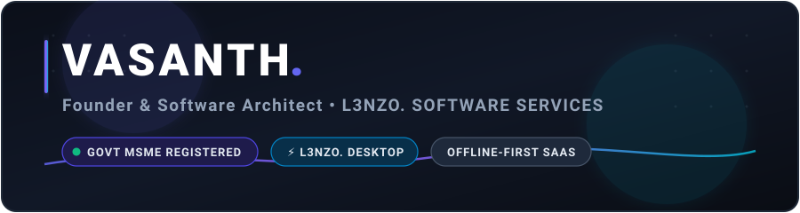

<div align="center">

  

  <br/><br/>

  <a href="https://github.com/vasanth5545">
    
  </a>

  <br/><br/>

  <p align="center">
    <a href="https://l3nzo.web.app"></a>
    <a href="mailto:vasanthvarman07@gmail.com"></a>
    <a href="https://github.com/vasanth5545/l3nzo"></a>
  </p>

</div>

---

### 👨‍💻 About Me

I am a **Software Architect & Startup Founder** building production-grade, low-latency desktop platforms and distributed cloud systems. Currently scaling **[L3NZO.](https://github.com/vasanth5545/l3nzo)**, a next-generation desktop operating software tailored for commercial wedding studios and high-volume creative agencies.

- 🚀 **Founder & CEO** of **L3NZO. SOFTWARE SERVICES** *(Govt. of India MSME Registered: `UDYAM-TN-25-0064013`)*.
- 💻 Specialized in **Offline-First Systems**, **Win32 High-Performance Desktop Apps**, and **Real-Time Data Sync Engines**.
- 🛠️ Obsessed with building ultra-fast 120 FPS UIs, strict security boundaries, zero-trust cloud architectures, and rock-solid native Windows installers.

---

### 🌟 Flagship Ecosystem: L3NZO.

<table>
  <tr>
    <td width="65%">
      <h3><a href="https://github.com/vasanth5545/l3nzo">⚡ L3NZO. (Windows Desktop Platform)</a></h3>
      <p>High-throughput photo proofing, real-time client selection, and automated studio directory management. Connects local raw photographic assets with live cloud selection events in under 50 milliseconds.</p>
      <p>
        
        
        
        
      </p>
      <p>👉 <strong><a href="https://github.com/vasanth5545/l3nzo">Explore L3NZO. Showcase &amp; Downloads</a></strong></p>
    </td>
    <td width="35%" align="center">
      
      <br/><br/>
      <a href="https://l3nzo.web.app">
        
      </a>
    </td>
  </tr>
</table>

---

### 🛠️ Core Engineering Stack

<div align="center">

| Domain | Technologies &amp; Frameworks |
| :--- | :--- |
| **Desktop &amp; Native** | `Flutter Desktop (Win32 x64)` • `Dart` • `Inno Setup Compiler` • `C++ Native Runner` • `Windows APIs` |
| **Cloud &amp; Distributed** | `Firebase Realtime Database (RTDB)` • `Cloud Firestore` • `Cloud Functions` • `Google Cloud Platform` |
| **Frontend &amp; Web** | `React.js` • `TypeScript` • `HTML5 / CSS3` • `Tailwind CSS` • `Vite` • `PWA` |
| **Databases &amp; Local Storage** | `SQLite (sqflite_common_ffi)` • `Cloud Firestore` • `IndexedDB` • `Redis / Local Caching` |
| **Security &amp; Architecture** | `Zero-Trust Client Boundary` • `SHA-256 Signatures` • `Storage Lifecycle Optimization` • `Clean Architecture` |

</div>

---

### 📊 GitHub Activity &amp; Engineering Metrics

<div align="center">
  
</div>

---

### 🏛️ Legal &amp; Enterprise Identity

```text
Enterprise Name : L3NZO. SOFTWARE SERVICES
Govt. of India  : Ministry of Micro, Small and Medium Enterprises (MSME)
Udyam Reg. No.  : UDYAM-TN-25-0064013
NIC Code        : 62011 (Computer Programming, Software Architecture & Cloud Solutions)
Headquarters    : Thiruvarur District, Tamil Nadu, India
```

---

<div align="center">
  <sub>Designed &amp; Maintained by Vasanth • Founder @ L3NZO. SOFTWARE SERVICES</sub>
</div>
